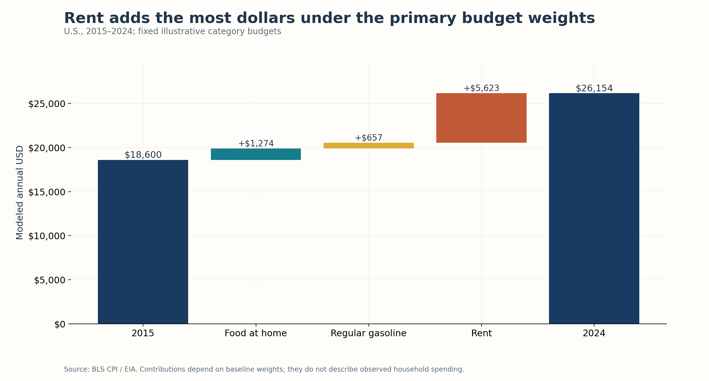
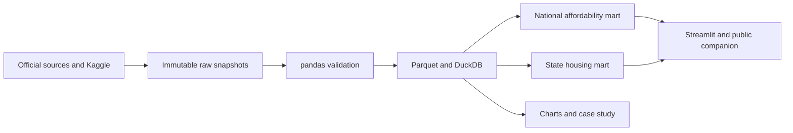

# The American Affordability Index

*A data-driven investigation into what it really costs to live in America.*

[Public dashboard](https://american-affordability-index.sunlittuna11.chatgpt.site) · [Executive case study](reports/executive_summary.md) · [Methodology](reports/METHODOLOGY.md) · [Source registry](reports/SOURCE_REGISTRY.md)

## Did income keep pace with selected essentials?

From 2015 to 2024, U.S. renter median household income grew **51.8%**, while a fixed illustrative rent, grocery and gasoline budget grew **40.6%**. The resulting affordability index is **108.0** (2015=100), about **8.0%** above baseline.

This is a model of selected costs and aggregate renter income. It does not establish that every renter became financially better off, describe actual household expenditure, or cover all living costs.

## Verified findings and decisions

- Rent adds **$5,623**, or **74.4%**, of the **$7,554** modeled annual increase. It warrants close monitoring under these weights; users can test their own budget.
- State housing is a separate product: the 2024 rent/renter-income proxy ranges from **23.6% in North Dakota** to **38.5% in Florida**. These point-estimate ratios are not actual burden prevalence or best-place-to-live rankings.
- Gasoline/grocery price-level correlation is **0.751**, versus **−0.073** for consecutive monthly changes (138 valid pairs). Correlation does not establish pass-through or forecasting value.
- Three illustrative 12-month paths from September 2026 price levels yield terminal monthly modeled costs of **$2,405 / $2,429 / $2,509**. They support assumption testing, not reliable forecasts.

For grocery businesses, seasonal produce and eggs show meaningful monthly price variability in the retained item series. Compare like months and investigate source context before treating movements as procurement risk. See [the full evidence and recommendations](reports/executive_summary.md).



## Business questions

1. Did household income keep pace with selected essential costs?
2. Which category contributed the most dollars to the modeled increase?
3. Where is state housing pressure greatest under explicit measures?
4. Did gasoline changes precede grocery changes?
5. Which states have favorable income-to-rent point estimates?
6. What income/cost adjustment restores a chosen 2015 ratio?

All six receive evidence-based answers and boundaries in [ANALYSIS_RESULTS.md](reports/ANALYSIS_RESULTS.md).

## Data and quality

| Source | Inputs | Coverage |
|---|---|---|
| Census ACS 1-year | B19013, B25119, B25064, B25070 | 2015–2019, 2021–2024; nation, 50 states and DC |
| BLS CPI-U NSA | Food at home, rent, all items | Jan 2015–Sep 2026; Oct 2025 unavailable |
| EIA | National regular/all-formulations gasoline | Jan 2015–Sep 2026 |
| Kaggle / BLS AP | 74 item price series, version 2 | Jan 2015–Jul 2026; uneven item coverage |

**695 official resources** are preserved with hashes. **7,488 ACS estimate/MOE records** pass coverage, key and source-universe reconciliation checks. The original Kaggle long file has no explicit nulls but omits 1,417 cells on a full item/month grid. Coffee and potato chips receive reviewed category corrections while source labels remain intact.

Standard ACS 2020 is missing. Annual affordability stops at 2024; 2025 ACS is scheduled for October 29, after this October 19 snapshot. Partial 2026 price data do not become annual affordability estimates. Official Summary Files resolve the Census API-key dependency without credentials.

[Data dictionary](reports/DATA_DICTIONARY.md) · [Quality results](reports/pipeline_quality.json) · [Validation evidence](reports/VALIDATION.md) · [Provenance](reports/PROVENANCE.md) · [Data reuse](DATA_LICENSES.md)

## Method and tools

The 2015 annual baseline is rent **$12,000**, food at home **$4,800**, gasoline **$1,800**. These illustrative component budgets grow by official price relatives. The national rent component uses rent CPI and omits utilities. State median gross rent includes applicable utilities and remains separate.

`Affordability index = 100 × (income / 2015 income) / (modeled costs / 2015 modeled costs)`

pandas validates and normalizes two ACS file formats. Parquet preserves analysis-ready facts. DuckDB implements the annual/calendar logic, joins, CASE/CTEs, rankings, LAG/LEAD and rolling calculations. SciPy computes descriptive correlations and sensitivities. Plotly/Matplotlib create interactive/static charts. Streamlit implements the four-page application. A generated browser-only companion publishes the same frozen results through Sites.



## Dashboard and simulator

The four pages are Overview, State Housing, Cost Breakdown and Simulator. Metrics carry dates, geography and assumptions. The simulator separates user inputs from historical observations. No personal inputs are stored. The public deployment is the browser-only companion; the tested Streamlit app is included for local use or a separate Streamlit Community Cloud deployment.

```bash
python3.13 -m venv .venv
source .venv/bin/activate
python -m pip install -r requirements-dev.txt
python src/run_pipeline.py --with-story
python -m pytest -q
node web/test_simulator.cjs
streamlit run app.py
```

The ordinary pipeline runs offline on frozen data. `--with-story` also rebuilds Markdown and PDF reports. `python src/ingest_data.py` fills missing source resources, validates API/file responses and hashes, retries bounded failures and honors rate limits. Existing source bytes cannot silently change. New vintages require a new snapshot folder and reviewed configuration change. No API key or scheduled refresh is needed.

Dependencies were validated with Python 3.13. For notebook execution, install requirements-dev.txt and use the Python kernel. The [executed notebook](notebooks/exploratory_analysis.ipynb) inspects the production outputs; transformation logic lives in scripts and SQL.

## Deliverables

- [Seven static charts and interactive HTML](visuals/)
- [Documented SQL queries](sql/analytical_queries.sql) and [query results](reports/sql_results/)
- [Executive brief PDF](output/pdf/executive_brief.pdf)
- [LinkedIn carousel PDF](output/pdf/linkedin_carousel.pdf)
- [LinkedIn case-study draft](reports/linkedin_case_study.md)
- [Interview walkthrough and five questions](reports/interview_preparation.md)
- [Milestone acceptance record](reports/MILESTONES.md)

## Limitations

The model omits major expenses/taxes and uses aggregate renter income with illustrative weights. ACS MOEs survive processing, but derived ratio/rank confidence intervals are not claimed. State comparisons measure housing/income only. CPI indexes and average-price series have different interpretations. Correlations and scenarios are descriptive. [Full limitations](reports/DATA_LIMITATIONS.md).

Live browser preview was declined by the browser approval gate. Application tests and browser-companion arithmetic checks pass; exported charts and PDFs were visually inspected. Real-browser responsive/map rendering remains unverified in this session.

Original code and writing: MIT. Source data and vendor assets retain their own notices. No government agency endorses the analysis. LinkedIn materials are prepared for review; no social post was sent.
